# Hey, I'm DranShineee 👋

<p align="center">
  
</p>

<p align="center">
  
</p>

<p align="center">
  <a href="https://github.com/DranShineee">
    
  </a>
  
  
</p>

---

## `whoami`

```text
Student      → Software & technology
Mindset      → Learn by building
Interests    → Web development, mobile apps, system design
Outside code → Training, exploring, staying active
Currently    → Learning, experimenting, improving
```

I'm a software development student who enjoys understanding how things work, building useful applications, and learning through hands-on projects.

I believe progress comes from consistency, curiosity, and being willing to start before everything feels perfect.

**Still learning. Still building. Always moving forward.**

## `tech_stack`

<p align="center">
  
</p>

## `github_stats`

<p align="center">
  
  
</p>

<p align="center">
  
</p>


## `contribution_activity`

<picture data-importer="pacman">
  <source media="(prefers-color-scheme: dark)" srcset="https://raw.githubusercontent.com/DranShineee/DranShineee/pacman-output/galaga-contribution-graph-dark.svg?game=galaga">
  <source media="(prefers-color-scheme: light)" srcset="https://raw.githubusercontent.com/DranShineee/DranShineee/pacman-output/galaga-contribution-graph.svg?game=galaga">
  
</picture>

###


## `beyond_the_screen`

```text
01 / BUILD     — Turn ideas into working projects.
02 / EXPLORE   — Keep learning beyond the classroom.
03 / TRAIN     — Cycling, running, and strength training.
04 / REPEAT    — Small improvements, consistently.
```

<p align="center">
  <i>Different disciplines. Same mindset: show up and put in the work.</i>
</p>

---

<p align="center">
  
  <br />
  <b>Thanks for stopping by.</b>
  <br />
  <sub>Built with curiosity, caffeine, and a suspicious number of commits.</sub>
</p>
